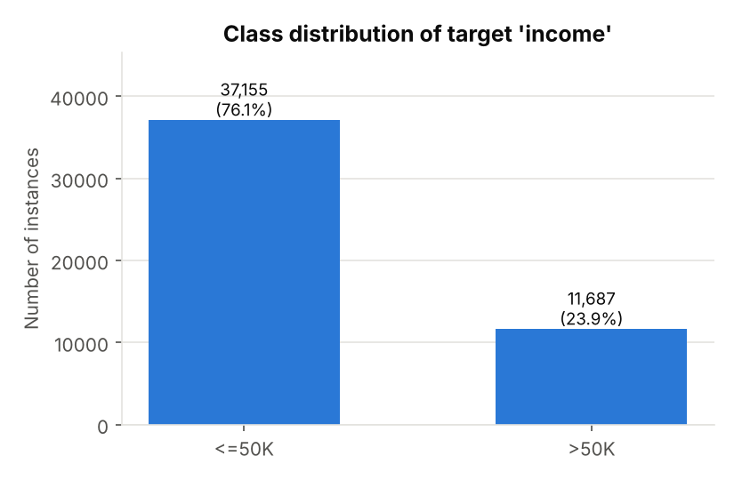
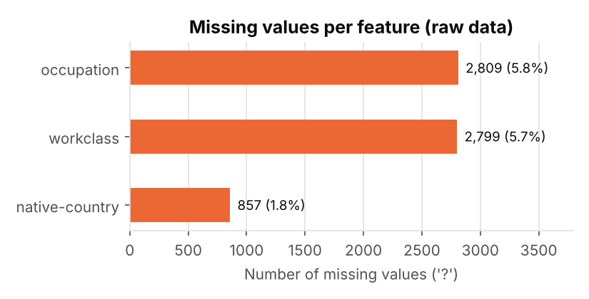
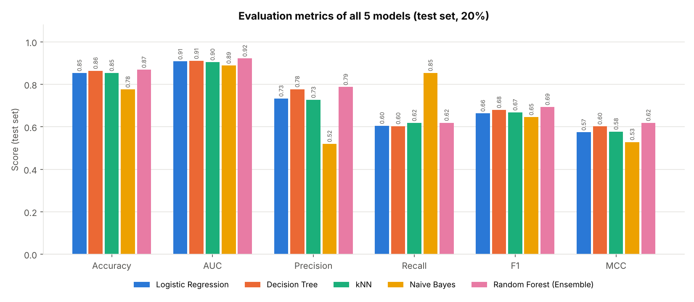
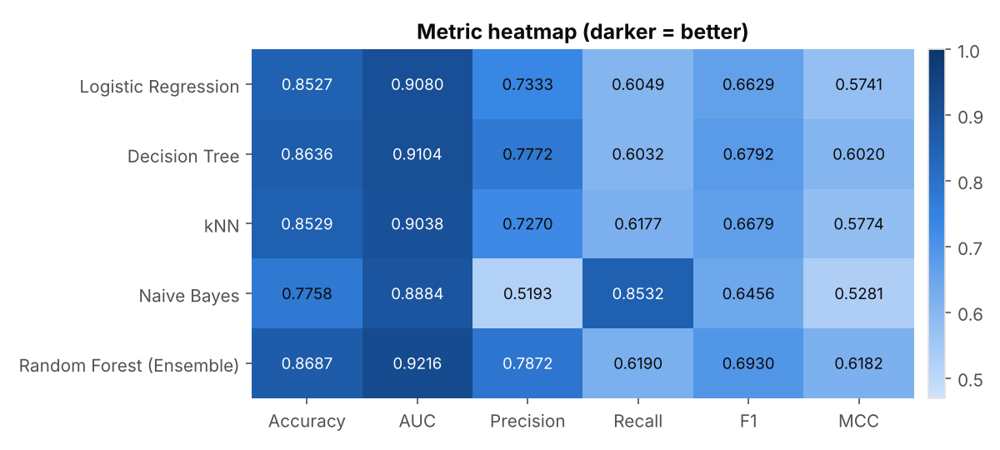
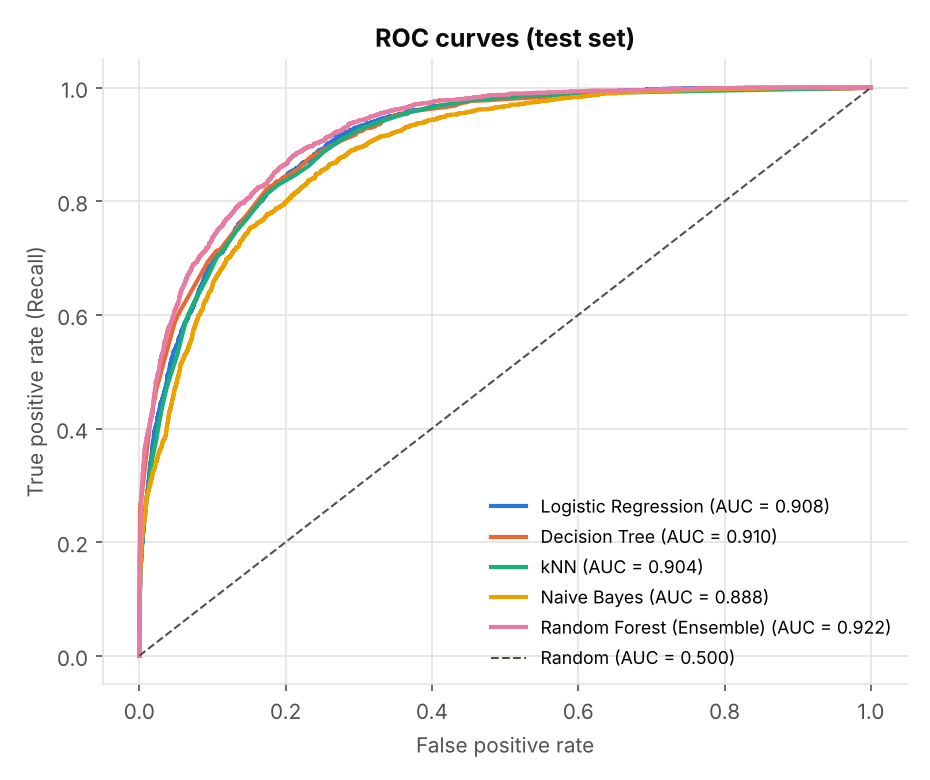
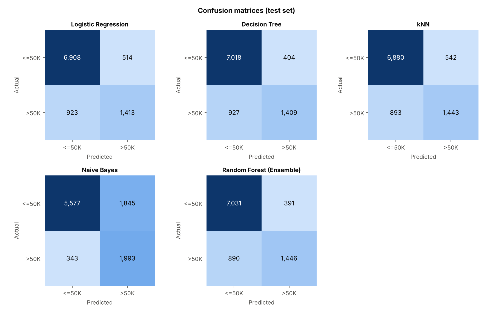

# ML Assignment 2 - Income Classification (UCI Adult Dataset)

M.Tech (AIML/DSE) - Machine Learning - Assignment 2

In this assignment I trained 5 classification models on the UCI Adult dataset and compared them using 6 evaluation metrics. All the models use the same dataset and the same 80:20 train-test split, so the comparison is fair.

---

## a. Problem Statement

The task is to predict whether a person earns more than 50K dollars a year (`>50K`) or not (`<=50K`) using census data such as age, education, occupation, working hours, marital status and so on. This is a binary classification problem. The classes are not balanced: only about 24% of the people are in the `>50K` class.

What I had to do:

1. Preprocess the data (missing values, duplicates, categorical columns, scaling)
2. Train Logistic Regression, Decision Tree, kNN, Naive Bayes and Random Forest on the same data
3. Calculate Accuracy, AUC, Precision, Recall, F1 and MCC for each model
4. Compare the models and find the best one for this dataset

---

## b. Dataset Description

| Item | Details |
|---|---|
| Dataset | Adult (Census Income) |
| Source | UCI Machine Learning Repository - https://archive.ics.uci.edu/dataset/2/adult |
| Files used | `adult.data` (32,561 rows) and `adult.test` (16,281 rows). I combined them and made my own 80:20 split |
| Total instances | 48,842 |
| Number of features | 14 (6 numeric, 8 categorical) |
| Target | `income` (`<=50K` = 0, `>50K` = 1) |
| Missing values | 6,465 values marked as `?`, in 3,620 rows (workclass: 2,799, occupation: 2,809, native-country: 857) |
| Duplicate rows | 52 |
| Class distribution | `<=50K`: 37,155 (76.07%), `>50K`: 11,687 (23.93%) |

**Why I chose this dataset:**

- It meets the requirements: 14 features (minimum is 12) and 48,842 rows (minimum is 1,000).
- It has actual missing values and duplicate rows, so the preprocessing part is meaningful and not just for show.
- It has both numeric and categorical columns, so I had to do encoding and scaling. This also affects different models in different ways (for example, kNN needs scaling but trees don't).
- The target is imbalanced, which makes the choice of metrics important.
- It is a well-known public dataset, so the results can be cross-checked easily.

**Feature types:**

| Feature | Type | Notes |
|---|---|---|
| age | Numeric | 17 to 90 |
| workclass | Categorical (8 values) | has missing values |
| fnlwgt | Numeric | census sampling weight, very large range |
| education | Categorical (16 values) | same info as education-num, so I dropped it |
| education-num | Numeric (ordinal) | 1 to 16 |
| marital-status | Categorical (7 values) | |
| occupation | Categorical (14 values) | has missing values |
| relationship | Categorical (6 values) | |
| race | Categorical (5 values) | |
| sex | Categorical (2 values) | |
| capital-gain | Numeric | mostly 0, very skewed |
| capital-loss | Numeric | mostly 0, very skewed |
| hours-per-week | Numeric | 1 to 99 |
| native-country | Categorical (41 values) | has missing values |
| **income** | **Target** | `<=50K` / `>50K` |





**Class imbalance:** The ratio is roughly 3:1 (76% vs 24%). A model that just predicts `<=50K` for everyone would already get about 76% accuracy, so accuracy on its own doesn't say much here. To deal with this:

- I used a stratified split, so the train and test sets both have the same class ratio (23.94% `>50K` in each).
- Along with accuracy I looked at AUC, F1 and MCC, which are better for imbalanced data.
- I used ROC-AUC as the scoring metric for hyperparameter tuning.
- I didn't do oversampling, because I wanted the test set to keep the real class ratio.

---

## Data Preprocessing

The code is in `model/data_preprocessing.py`.

1. **Missing values:** The `?` values are read as NaN. Categorical columns are filled with the most frequent value, and numeric columns with the median. Numeric columns don't actually have missing values, but I kept the median imputer just in case. The imputation is done inside the pipeline, so it is learned from the training data only.
2. **Duplicates:** I removed the 52 duplicate rows, which leaves 48,790 rows.
3. **Encoding:** One-hot encoding for the 7 categorical columns (with `handle_unknown="ignore"`). The target is converted to 0/1. I dropped `education` because `education-num` already has the same information as a number. After encoding there are 89 columns.
4. **Scaling:** StandardScaler on the numeric columns, but only for Logistic Regression, kNN and Naive Bayes. Decision Tree and Random Forest don't need scaling because they split on thresholds.
5. **Train-test split:** 80:20, which gives 39,032 rows for training and 9,758 for testing.
6. **Class distribution:** `stratify=y` is used in the split.
7. **Random seed:** `random_state = 42` everywhere.
8. **No data leakage:** The imputer, encoder and scaler are put together with the model in a sklearn `Pipeline`. The pipeline is fitted only on `X_train`, and the test data is only transformed. Grid search also uses only the training data (5-fold CV).

The test split I used for evaluation is saved as `test_data.csv`.

---

## c. GitHub Repository Link

https://github.com/2026ct05187/ML_Assignment_2

**Folder structure:**

```
ML_Assignment_2/
|-- README.md
|-- requirements.txt
|-- test_data.csv               (test split used for evaluation)
|-- data/                       (adult.data, adult.test, adult.names from UCI)
|-- model/
|   |-- data_preprocessing.py
|   |-- evaluation.py
|   |-- logistic_regression.py
|   |-- decision_tree.py
|   |-- knn.py
|   |-- naive_bayes.py
|   |-- random_forest.py
|   |-- train_all.py            (runs everything)
|   |-- evaluate_saved_models.py
|   |-- ML_Assignment_2.ipynb
|   |-- saved_models/           (.pkl files of all 5 trained models)
|-- results/
    |-- metrics_comparison.csv
    |-- grid_search_log.txt
    |-- plots/
```

**How to run:**

```bash
git clone https://github.com/2026ct05187/ML_Assignment_2.git
cd ML_Assignment_2
pip install -r requirements.txt

# run all 5 models (takes about a minute)
python model/train_all.py

# optional: run the grid search again (takes 10-15 min)
python model/train_all.py --tune

# optional: run just one model
python model/random_forest.py

# optional: check the saved models on test_data.csv
python model/evaluate_saved_models.py
```

You can also open `model/ML_Assignment_2.ipynb` and run all cells. The dataset files are already in the `data/` folder.

---

## d. Models Used

I implemented all 5 models with scikit-learn. Each one is a pipeline of preprocessing followed by the classifier. To pick the hyperparameters I used GridSearchCV with 5-fold stratified CV on the training data, with ROC-AUC as the scoring metric. The test data was not used for tuning.

| Model | Scaling | Parameters tried | Best parameters | CV AUC |
|---|---|---|---|---|
| Logistic Regression | Yes | C = 0.01, 0.1, 1, 10 | C = 0.1 | 0.9045 |
| Decision Tree | No | criterion, max_depth (6 to 15, None), min_samples_leaf (1 to 50) | gini, max_depth = 10, min_samples_leaf = 50 | 0.9044 |
| kNN | Yes | k = 5, 11, 21, 31, 41; uniform / distance weights | k = 41, uniform | 0.8968 |
| Naive Bayes (Gaussian) | Yes | var_smoothing from 1e-9 to 0.3 | var_smoothing = 0.01 | 0.8853 |
| Random Forest | No | max_depth (None, 15, 25), min_samples_leaf (1, 3, 5), 300 trees | max_depth = 25, min_samples_leaf = 3 | 0.9171 |

I used Gaussian Naive Bayes instead of Multinomial because the data has continuous features (which become negative after scaling). Multinomial NB only works with non-negative counts.

### Comparison Table (on the test set, 9,758 rows)

| ML Model Name | Accuracy | AUC | Precision | Recall | F1 | MCC |
|---|---|---|---|---|---|---|
| Logistic Regression | 0.8527 | 0.9080 | 0.7333 | 0.6049 | 0.6629 | 0.5741 |
| Decision Tree | 0.8636 | 0.9104 | 0.7772 | 0.6032 | 0.6792 | 0.6020 |
| kNN | 0.8529 | 0.9038 | 0.7270 | 0.6177 | 0.6679 | 0.5774 |
| Naive Bayes | 0.7758 | 0.8884 | 0.5193 | 0.8532 | 0.6456 | 0.5281 |
| Random Forest (Ensemble) | 0.8687 | 0.9216 | 0.7872 | 0.6190 | 0.6930 | 0.6182 |

Precision, Recall and F1 are calculated for the `>50K` class. AUC is calculated from the predicted probabilities.

### Graphs

#### Bar chart of all metrics



#### Heatmap



#### ROC curves



#### Confusion matrices



### Observations

| ML Model Name | Observation about model performance |
|---|---|
| Logistic Regression | It did well for a simple linear model: 85.27% accuracy and 0.908 AUC, about 9% better than just predicting the majority class. Its recall for `>50K` is only 0.60, so it misses around 40% of the high earners. I think this is because of the class imbalance, and because a linear boundary can't capture things like the sudden jump in income when capital-gain is high. The best C was 0.1, which means a bit of regularisation helped (there are 89 columns after one-hot encoding). It was also very fast to train. |
| Decision Tree | This was the second-best model. Its accuracy (86.36%) and MCC (0.602) are better than Logistic Regression. A tree can learn rules like "married + high education + capital gain above some value", which suits this data. Limiting the tree was very important. A fully grown tree had a CV AUC of only 0.749 because it overfit badly, while the pruned tree (max_depth 10, min_samples_leaf 50) got 0.904. Precision is good (0.777) but recall is still about 0.60. |
| kNN | The results were almost the same as Logistic Regression (85.29% accuracy, 0.904 AUC, 0.577 MCC). A large k worked better: k = 5 gave a CV AUC of 0.857 and k = 41 gave 0.897, probably because the two classes overlap a lot and a bigger k smooths things out. Scaling was necessary, because otherwise fnlwgt (values in lakhs) would dominate the distance. It was also the slowest model at prediction time, since it compares each test row with all 39k training rows. |
| Naive Bayes | This had the lowest accuracy (77.58%), precision (0.519) and MCC (0.528), but by far the highest recall (0.853). So it catches most of the `>50K` people, but almost half of its `>50K` predictions are wrong (1,845 false positives). The reason is that its assumptions don't hold for this data: the features are not independent (relationship, marital-status and sex are clearly related), and one-hot and capital-gain columns are not Gaussian at all. Its AUC is still 0.888, so the ranking of people is okay, and a different threshold would probably help. |
| Random Forest (Ensemble) | This was the best model. It had the highest accuracy (86.87%), AUC (0.9216), precision (0.787), F1 (0.693) and MCC (0.618), and the fewest false positives (391). Averaging 300 trees reduces the overfitting of a single tree, so it beats the Decision Tree on every metric. The downsides are that it takes longer to train, the saved model is bigger (about 13 MB) and it is harder to explain than a single tree. |
| Overall Winner for your dataset? | Random Forest. It is the best on 5 out of the 6 metrics, including F1 and MCC, which matter most here because the data is imbalanced. By MCC, the order is Random Forest > Decision Tree > kNN ≈ Logistic Regression > Naive Bayes. The tree-based models did best, which makes sense because income depends on thresholds and combinations of features. If the goal was to catch as many `>50K` people as possible, Naive Bayes (recall 0.853) or lowering the threshold of the other models could be considered. |

**A few more points I noticed:**

- All the models beat the 76% baseline, and their AUCs are quite close (0.888 to 0.922). The bigger differences show up in precision and recall at the default 0.5 threshold.
- Except for Naive Bayes, all the models have recall of only about 0.60-0.62 for the `>50K` class, which shows the effect of the imbalance. Using `class_weight="balanced"` or tuning the threshold could improve this.

---

**Reproducibility:** `random_state = 42` is used everywhere, so running `python model/train_all.py` again gives the same numbers as the table above.
